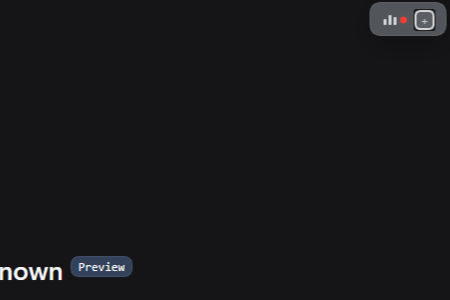
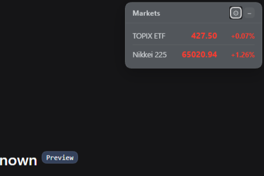
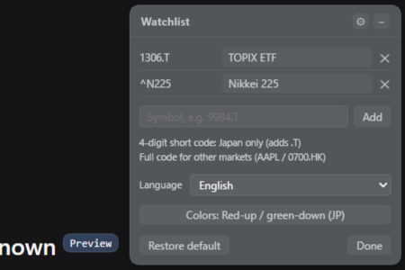

# 🧩 dsh-ticker-jp

English · [简体中文](./README.zh-CN.md) · [日本語](./README.ja.md)

[](https://awesome-dsh-plugin.com)
[](LICENSE)
[](https://www.npmjs.com/package/dsh-ticker-jp)
[](https://www.dsh.so/artifact/dsh-ticker-jp/)
[](https://www.dsh.so/artifact/dsh-ticker-jp/)

A draggable stock ticker that sits in the top-right corner of DeepSeek Harness. It starts with the TOPIX-linked ETF (`1306.T`) and the Nikkei 225 (`^N225`). Add anything else Yahoo Finance serves: Japanese (`.T`), US, Hong Kong (`.HK`) and mainland China (`.SS`/`.SZ`) symbols all work. The floating window is from [dsh-stock-ticker](https://github.com/FeiZhuNiU-INFJA/dsh-stock-ticker); this fork only changes where the quotes come from.

## 📸 Preview

<p align="center">
  
  
  
</p>

## ✨ Features

- Draggable, collapsible window that follows the DSH theme
- One row per symbol with name, price and change percent; red for up by default
- Watch any market Yahoo covers, with 4-digit shorthand for Japanese codes and `code:display name` aliases
- Polling drops to once a minute while every watched market is closed, and runs every 5 seconds otherwise
- Up/down colours switch between the Japanese and US conventions
- 16 UI languages, picked from the browser on first run and changeable at any time
- Window position, collapsed state, watchlist, palette and language all persist locally
- "Restore default" brings back the original two symbols

### Default symbols

| Display   | Code     | Note                                                                      |
| --------- | -------- | ------------------------------------------------------------------------- |
| TOPIX ETF | `1306.T` | Yahoo no longer serves the TOPIX index, so its linked ETF is used instead |
| 日経225   | `^N225`  | The Nikkei 225 index                                                      |

## 📋 Requirements

| Item    | Requirement                                                      |
| ------- | ---------------------------------------------------------------- |
| DSH     | `>=0.1.0-rc.7 <0.3.0` (checked on `0.1.7-rc.2` and `0.2.1-rc.2`) |
| Node.js | `^22.19.0` or `>=24.0.0`                                         |

DSH reads `engines.dsh` at startup to decide whether it will load the plugin, so the range lives there. `@deepseek-ai/dsh-client-ui-slots` is declared as a peer only and does not need to be installed. No other DSH-side package is required.

## 🚀 Install

The npm package is prebuilt, so there is no build approval to grant. You can also install straight from the GitHub source.

```bash
# npm (recommended)
dsh plugin --profile web add dsh-ticker-jp

# GitHub source
dsh plugin --profile web add github:MurasakiIzumi/dsh-ticker-jp
```

Restart DSH (or pick "restart now") and the widget appears in the top-right corner.

## ⚙️ Usage

1. Click **⚙** in the title bar to open the settings.
2. Each row has a code, a display-name field and a remove button. Name edits apply right away; leave it empty to fall back to the built-in shorthand, then the Yahoo name, then the code.
3. Add symbols in the box at the bottom: `9984.T`, `AAPL`, or `9984` (a bare 4-digit code gets `.T`, Japan only). `9984.T:SoftBank` adds an alias.
4. Palette and language sit in the middle of the panel and apply immediately.
5. "Restore default" brings back the TOPIX ETF and the Nikkei 225; "Done" closes the panel.

## 🗂️ Code structure

```
dsh-ticker-jp/
├── lib/index.js       # Host: registers the /dsh-ticker-jp/quotes route
├── lib/client.js      # Client: widget UI, polling, watchlist/aliases
├── lib/index.d.ts     # Host type declarations
├── lib/client.d.ts    # Client type declarations
├── host.js            # Dynamic-plugin host half (optional)
├── client.js          # Dynamic-plugin client half (optional)
├── package.json       # Package manifest
├── cordis.patch.yml   # Bundle patch
├── CHANGELOG.md       # Changelog
├── assets/            # Screenshots
├── LICENSE
├── README.md          # English (main)
├── README.zh-CN.md    # 简体中文
└── README.ja.md       # 日本語
```

The same code ships in two forms: `lib/` is the bundle that stays installed in DSH, while `host.js` / `client.js` form the dynamic-plugin variant for a temporary run. They behave the same.

## 🔌 Data source

- Yahoo Finance chart API: `https://query1.finance.yahoo.com/v8/finance/chart/{code}?interval=1d&range=1d`
- Free and unauthenticated. Price comes from `meta.regularMarketPrice`, change percent from `meta.regularMarketChangePercent`, and the name from `longName`/`shortName`
- Covers Japan `.T`, the US, Hong Kong `.HK`, mainland China `.SS`/`.SZ` and any other exchange Yahoo serves
- Each quote carries its exchange timezone and exchange name, so the client can tell when the local market trades
- Names are not hard-coded; only the two defaults are renamed for display

## 🧪 Dynamic plugin (optional)

Try it without installing:

1. Create a plugin with `cordis_define`; paste [host.js](./host.js) as `code.host` and [client.js](./client.js) as `code.client`.
2. Activate it with `cordis_run` and approve the client on first run.
3. Refresh the page and the widget appears.

The dynamic form behaves like the bundle. The only difference is how the host fetches: the dynamic host runs in a restricted sandbox and goes through `ctx.web`, while the bundle uses native `fetch`. The RPC contract is the same.

## 📄 License

[MIT](./LICENSE)

The floating-window implementation and structure come from [FeiZhuNiU-INFJA](https://github.com/FeiZhuNiU-INFJA)'s [dsh-stock-ticker](https://github.com/FeiZhuNiU-INFJA/dsh-stock-ticker) (Copyright (c) 2026 Yulin). This fork replaces the data source, adds the watchlist and extends coverage to worldwide markets (Copyright (c) 2026 XuZhichao).
