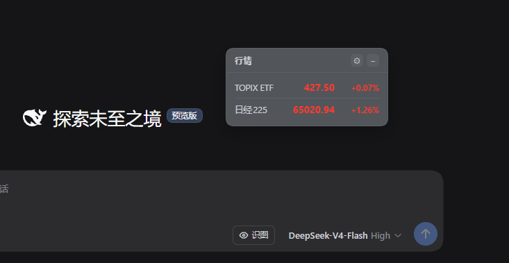
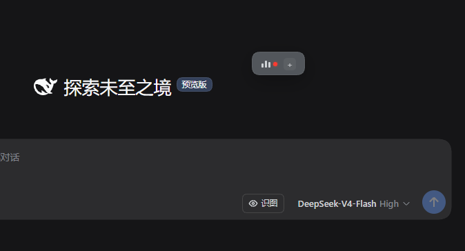
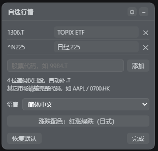

# 🧩 dsh-ticker-jp

[English](./README.md) · **简体中文** · [日本語](./README.ja.md)

[](LICENSE)
[](https://www.npmjs.com/package/dsh-ticker-jp)
[](https://awesome-dsh-plugin.com)
[](https://www.dsh.so/artifact/dsh-ticker-jp/)
[](https://www.dsh.so/artifact/dsh-ticker-jp/)

页面右上角挂着一个悬浮行情小窗，默认显示 TOPIX 联动 ETF（`1306.T`）和日经225（`^N225`）。想看别的市场自己加：日股填 4 位代码，美股、港股（`.HK`）、A 股（`.SS`/`.SZ`）填完整代码，Yahoo 能查到的都能加。浮窗交互沿用上游 [dsh-stock-ticker](https://github.com/FeiZhuNiU-INFJA/dsh-stock-ticker)，数据源换成了 Yahoo Finance。

## 📸 预览

<p align="center">
  
  
  
</p>

## ✨ 功能

- 浮窗能拖动、能收起，配色跟着 DSH 主题走
- 一行一个标的，显示名称、价格、涨跌幅；默认红涨绿跌
- 自选不限日本：日股 `.T`、美股、港股 `.HK`、A 股 `.SS`/`.SZ` 等都能加。4 位纯数字自动补 `.T`，也可以用 `代码:显示名` 起别名
- 全部自选市场休市时，刷新降到每分钟一次；开市时是 5 秒一次
- 涨跌配色可以在日式和美式之间切换
- 界面支持 16 种语言，第一次按浏览器语言选，之后随时改
- 窗口位置、收起状态、自选列表、配色、语言都保存在本地
- 点「恢复默认」回到初始的两只标的

### 默认标的

| 显示名    | 代码     | 说明                                             |
| --------- | -------- | ------------------------------------------------ |
| TOPIX ETF | `1306.T` | Yahoo 的 TOPIX 指数接口已停更，以其联动 ETF 代替 |
| 日経225   | `^N225`  | 日经225 指数本体                                 |

## 📋 环境要求

| 项目    | 要求                                                       |
| ------- | ---------------------------------------------------------- |
| DSH     | `>=0.1.0-rc.7 <0.3.0`（`0.1.7-rc.2`、`0.2.1-rc.2` 核对过） |
| Node.js | `^22.19.0` 或 `>=24.0.0`                                   |

DSH 启动时会读 `engines.dsh`，用它判断这个插件能不能加载，版本区间就写在那里。`@deepseek-ai/dsh-client-ui-slots` 只作为 peer 依赖声明，不需要单独安装；除此之外不依赖 DSH 的其他官方包。

## 🚀 安装

npm 上的版本是预构建的，装的时候不用给构建授权；也可以直接从 GitHub 源码装。

```bash
# npm（推荐）
dsh plugin --profile web add dsh-ticker-jp

# GitHub 源码
dsh plugin --profile web add github:MurasakiIzumi/dsh-ticker-jp
```

装完重启 DSH（或点「立即重启」），窗口就出现在页面右上角。

## ⚙️ 使用

1. 点标题栏的 **⚙** 打开设置。
2. 每行是代码、显示名和移除按钮。显示名改完立刻生效；留空就依次用默认简称、Yahoo 的名称、代码。
3. 底部输入框加标的：`9984.T`、`AAPL`、`9984`（4 位纯数字只对日股补 `.T`）；写成 `9984.T:软银` 可以带别名。
4. 配色和语言在面板中间，改完立刻生效。
5. 「恢复默认」回到初始的两只，「完成」关掉面板。

## 🗂️ 代码结构

```
dsh-ticker-jp/
├── lib/index.js       # Host：注册 /dsh-ticker-jp/quotes 路由
├── lib/client.js      # Client：悬浮窗 UI、轮询、自选/别名
├── lib/index.d.ts     # Host 类型声明
├── lib/client.d.ts    # Client 类型声明
├── host.js            # 动态插件 Host 半区（可选）
├── client.js          # 动态插件 Client 半区（可选）
├── package.json       # 包清单
├── cordis.patch.yml   # bundle patch
├── CHANGELOG.md       # 变更记录
├── assets/            # 预览截图
├── LICENSE
├── README.md          # English（主文档）
├── README.zh-CN.md    # 简体中文
└── README.ja.md       # 日本語
```

同一份代码有两种形态：`lib/` 是随 DSH 常驻的 bundle 入口；`host.js` / `client.js` 是动态插件形态，临时体验用，功能一样。

## 🔌 数据源

- Yahoo Finance chart API：`https://query1.finance.yahoo.com/v8/finance/chart/{代码}?interval=1d&range=1d`
- 免费、不用鉴权。价格取 `meta.regularMarketPrice`，涨跌幅取 `meta.regularMarketChangePercent`，名称取 `longName`/`shortName`
- 日股 `.T`、美股、港股 `.HK`、A 股 `.SS`/`.SZ`，这些市场都能看
- 返回里带着交易所时区和交易所名，客户端拿它判断当地在不在交易时段
- 名称不自己维护，用 Yahoo 返回的；只有默认那两只会换成本地简称显示

## 🧪 动态插件（可选）

不装也能先看看效果：

1. 用 `cordis_define` 建插件，`code.host` 贴 [host.js](./host.js)，`code.client` 贴 [client.js](./client.js)。
2. `cordis_run` 激活，客户端第一次运行会弹审批，点「允许」。
3. 刷新页面，浮窗就出来了。

动态形态和 bundle 用起来一样，只有 Host 取数的方式不同：动态形态跑在受限沙箱里，走 `ctx.web`；bundle 直接用原生 `fetch`。两边的 RPC 契约相同。

## 📄 License

[MIT](./LICENSE)

浮窗实现与结构来自 [FeiZhuNiU-INFJA](https://github.com/FeiZhuNiU-INFJA) 的 [dsh-stock-ticker](https://github.com/FeiZhuNiU-INFJA/dsh-stock-ticker)（Copyright (c) 2026 Yulin）。本改版换了数据源，加了自选，把覆盖范围扩到了全球市场（Copyright (c) 2026 XuZhichao）。
